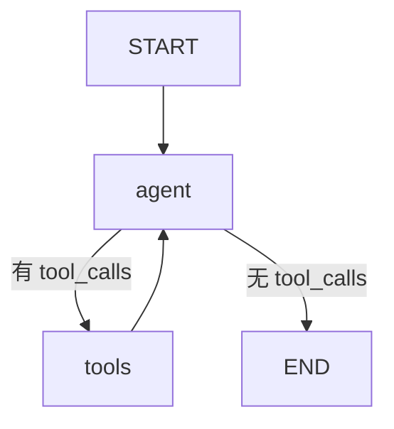

用 `create_react_agent` 三行代码就能起一个 Agent，但面试一问"底层怎么做"就卡壳。这篇把手写 StateGraph 的每一步拆开——节点、条件边、消息链，以及一个我实际踩到、修了半天的坑。

## 一、ReAct 闭环到底是什么

ReAct = 思考（Reasoning）+ 行动（Acting）。一个闭环在当前代码里就是 4 条消息：

```
HumanMessage  →  AIMessage(tool_calls)  →  ToolMessage  →  AIMessage(最终答案)
  用户问题          决定调工具              工具返回结果        带来源的回答
```

`create_react_agent` 把这 4 步封装好了。手写一遍才能回答"为什么最后一条消息没有 tool_calls 就该结束"。

## 二、手写状态图的三块积木

第一块是**模型节点**。它看最后一条消息：如果是工具返回结果，就组织答案；如果是用户新问题，就决定是否产出工具调用。

```python
def call_model(state):
    last = state.messages[-1]
    if last.role == "tool":              # 观察到结果了
        return {"messages": [Message("ai", f"根据证据：\n{last.content}")]}
    decision = llm.decide(last.content)  # 要不要查工具
    if decision["tool"]:
        return {"messages": [Message("ai", "", tool_calls=[decision])]}
    return {"messages": [Message("ai", "无需检索。")]}
```

第二块是**条件边**，判断图该往哪走：

```python
def should_continue(state):
    return "tools" if state.messages[-1].tool_calls else "__end__"
```

第三块是**工具节点**，执行调用并把结果作为 `ToolMessage` 追加回状态：

```python
def tool_node(state):
    out = []
    for call in state.messages[-1].tool_calls:
        result = invoke_tool(call["tool"], call["args"])
        out.append(Message("tool", result, name=call["tool"]))
    return {"messages": out}
```

组装起来，就是一张状态图：



## 三、我踩过的坑：循环只跑了一步

第一版跑出来只有一条 `HumanMessage`，后面全没了。原因是节点执行完后，我按普通边取下一节点——`agent` 节点没有普通边，直接跳到 END，条件边根本没走到。

正确的路由顺序是：**节点执行完，先查条件边，再查普通边**。

```python
result = self.g.nodes[node](state)
state.messages.extend(result["messages"])
if node in self.g.conditional:          # 条件边优先
    router, mapping = self.g.conditional[node]
    node = mapping[router(state)]
else:                                    # 没有条件边才走普通边
    node = self.g.edges.get(node, "__end__")
```

这个 bug 单看代码不明显，只有打印消息链才发现——所以**留证据比调代码更重要**。

## 四、参数校验和有限重试

工具调用不能裸奔。参数用 Schema 校验（生产用 Pydantic `args_schema`，本仓库用等价的 Python 校验器），错误在执行前就被拦下：

```python
class SearchInput:
    def __init__(self, query: str):
        if not isinstance(query, str): raise ValidationError("query 必须是字符串")
        if not query.strip():          raise ValidationError("query 不能为空")
```

重试有个关键细节：**参数错误不重试**（传错参数重试一万次还是错），只对执行期异常重试，且要有上限和指数退避，否则 Agent 会卡在死循环里。

```python
except ValidationError:
    raise                              # 参数错误直接抛
except Exception:
    attempts += 1
    if attempts <= retries:
        time.sleep(delay * (2 ** (attempts-1)))   # 0.01 → 0.02 → 0.04
```

## 五、真实运行结果

问"混合检索为什么要用BM25"，完整 4 条消息链：

```
HumanMessage : 混合检索为什么要用BM25
AIMessage    : (tool_calls=[search_kb])
ToolMessage  : name=search_kb | 混合检索的价值在于互补：稠密向量负责语义召回...
AIMessage    : 根据检索到的证据回答：... [来源: 01_rag_concepts#000, ...]
```

问"你好"时不调工具，直接返回——证明条件边的两个分支都生效。

## 六、写在最后

手写 ReAct 的价值不在"重新造轮子"，而在于你能回答三个问题：消息怎么在节点间传、条件边怎么决定终止、工具失败怎么兜底。把消息链打印出来，这三个问题都有证据。

代码在仓库 `multi-agent/react_agent.py`，完整运行证据在 `multi-agent/evidence/react_message_chain.json`。
