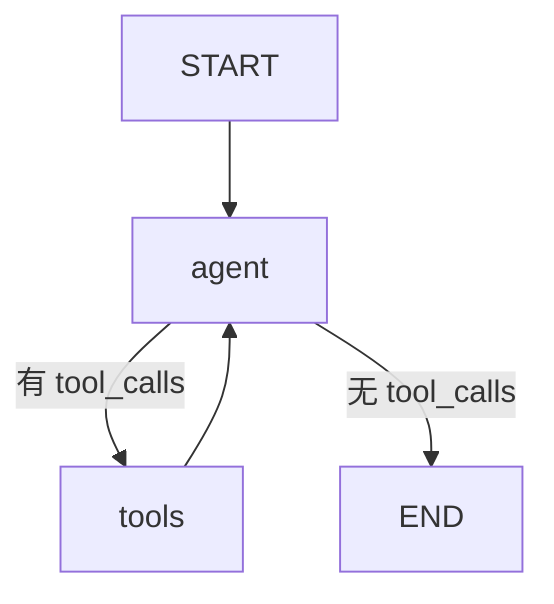

# 项目二：ReAct 多智能体问答系统

基于 LangGraph 设计思想实现的 ReAct 多智能体问答骨架，复用项目一 RAG 链作为检索工具。

## 一句话说明

把项目一的 RAG 链封装成工具，用**手写 StateGraph**跑通 ReAct 思考-行动-观察闭环，编排**规划/检索/汇总**三类 Agent，加会话记忆与摘要压缩，最后封成 HTTP 服务（`curl` 测通）。

## 运行环境与诚实边界

| 组件 | 本仓库实现 | 生产升级 |
|---|---|---|
| LLM 决策 | 本地规则（无 Key 不编造知识） | 配 `DEEPSEEK_API_KEY` 自动切 Function Calling |
| StateGraph | 纯标准库手写（节点/条件边/路由） | `langgraph` 官方 API |
| 工具 Schema | 纯 Python 校验器 | Pydantic `args_schema` + `@tool` |
| HTTP 服务 | 标准库 `http.server`（已 curl 测通） | FastAPI（`main.py`，装依赖即用） |
| Docker | **未构建验证**（本环境无 Docker） | 装 Docker 后按下方命令构建 |

**所有证据都是真实运行产出的**；未装的组件（FastAPI/Docker/LangGraph）不伪造运行结果，代码已写好升级入口。Docker 部分仅提供配置，未做构建验证。

## 目录结构

```
multi-agent/
├── tools.py            # 工具定义 + Schema 校验 + 异常捕获/有限重试
├── llm.py              # LLM 抽象层（DeepSeek Function Calling / 本地规则）
├── react_agent.py      # 手写 ReAct StateGraph + 消息链 + Mermaid 图
├── agents.py           # 三类 Agent 编排 + 会话记忆 + 上下文摘要压缩
├── server.py           # 标准库 HTTP 服务（/health /ask /docs）
├── main.py             # FastAPI 版本（装依赖后启动）
├── Dockerfile          # 容器化配置（未验证）
├── requirements.txt    # 可选升级依赖
├── run_all.sh          # 一键复现全部流程并留证
└── evidence/           # 真实运行证据
```

## 一键复现

```bash
cd multi-agent
bash run_all.sh
```

会生成 7 份证据：`tools_check.txt`（校验/重试）、`react_message_chain.json`（完整消息链）、`react_no_tool.json`（闲聊不调工具）、`multi_agent_output.json`（三类 Agent）、`state_graph_mermaid.md`（两张架构图）、`curl_results.txt`（服务返回）。

## 核心证据摘要

**ReAct 完整消息链**（`evidence/react_message_chain.json`）：

```
HumanMessage  -> AIMessage(tool_calls=[search_kb]) -> ToolMessage(search_kb) -> AIMessage(带来源答案)
```

这是 ReAct 思考-行动-观察闭环的直接证据。`message_count=4` 已在 `/ask` 返回中验证。

**三类 Agent trace**（`evidence/multi_agent_output.json`）：

```
[planner] 生成 2 个检索步骤
[retriever] 汇总 2 份证据
[summarizer] 基于证据生成带来源答案
```

**HTTP 服务**（`evidence/curl_results.txt`）：`/health` 返回 `{"status":"ok"}`，`/ask` 返回带来源答案，空问题返回 422 校验错误。

## 状态流转图



三类 Agent 编排：


## 生产部署（装好依赖后）

```bash
pip install -r requirements.txt
export DEEPSEEK_API_KEY=sk-xxxx          # 可选：切真实 Function Calling
uvicorn main:app --host 0.0.0.0 --port 8000
curl -X POST http://127.0.0.1:8000/ask -H 'Content-Type: application/json' \
  -d '{"question":"混合检索为什么要用BM25"}'

docker build -t ai-kb .
docker run -p 8000:8000 --env-file .env ai-kb
```

> 注：本仓库 `evidence/` 只含标准库版本（server.py）的 curl 结果。FastAPI / Docker 的验证需在有依赖和 Docker 的环境本地完成。
