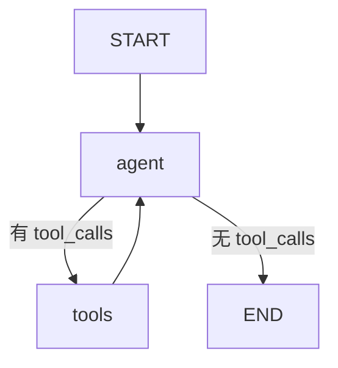

# 05 用 LangGraph 手写一个 ReAct Agent（附状态流转图）

> 对应技能：Agent 状态编排 ｜ **状态：预备稿（项目二尚未实施，代码骨架来自手册，运行证据待补）**
>
> ⚠️ 本篇的代码是待实现的设计稿，不是已跑通的结果。项目二完成后需补：真实运行输出、Mermaid 状态图截图、Agent 消息链截图。在此之前不要把本篇当"已完成项目"发出去。

## 1. 背景与目标

`create_react_agent` 是封装好的高层 API，但面试一定会问"底层怎么实现"。目标是手写一个 ReAct 循环（思考-行动-观察），理解模型节点、工具节点和条件边如何协作，并能画出状态流转图。

## 2. 环境与依赖

- Python 3.11+，`langgraph>=1.0`、`langchain-core`、`pydantic>=2`
- 需要配置大模型 Key（项目二依赖真实 LLM，不能用本项目一的纯标准库基线）
- 复用项目一的 RAG 链作为一个检索工具

## 3. 核心实现（设计稿）

Step 1 工具定义 + Schema 校验 + 有限重试：

```python
class SearchInput(BaseModel):
    query: str = Field(description="要检索的问题，不能为空")

@tool("search_kb", args_schema=SearchInput)
def search_kb(query: str) -> str:
    """在企业知识库中检索相关内容。"""
    if not query.strip():
        raise ValueError("query 不能为空")
    return rag.invoke(query)

def with_retry(fn, max_retries=2, delay=1):
    for i in range(max_retries + 1):
        try:
            return fn()
        except Exception as e:
            if i == max_retries:
                return f"调用失败：{e}"
            time.sleep(delay * (2 ** i))   # 指数退避
```

Step 3 手写 StateGraph 循环：

```python
model_with_tools = llm.bind_tools([search_kb])
tool_node = ToolNode([search_kb])

def call_model(state):
    return {"messages": [model_with_tools.invoke(state["messages"])]}

def should_continue(state):
    last = state["messages"][-1]
    return "tools" if getattr(last, "tool_calls", None) else "__end__"

builder = StateGraph(MessagesState)
builder.add_node("agent", call_model)
builder.add_node("tools", tool_node)
builder.add_edge(START, "agent")
builder.add_conditional_edges("agent", should_continue,
                              {"tools": "tools", "__end__": END})
builder.add_edge("tools", "agent")
graph = builder.compile()

print(graph.get_graph().draw_mermaid())   # 输出状态流转图
```

状态流转：



## 4. 关键参数与踩坑

- `should_continue` 检查最后一条消息有没有 `tool_calls`：有去工具节点，没有到 END。
- 工具节点执行完把结果作为 `ToolMessage` 追加回状态，再回到模型节点——这是"观察"环节。
- 参数校验用 Pydantic `args_schema`，模型传错参数在执行前被拦下。
- 重试要有上限（2 次）+ 指数退避，避免无限循环。

## 5. 结果验证（待补）

项目二完成后需要采集并放入 `evidence/`：

- [ ] `react_message_chain.txt`：HumanMessage → AIMessage(tool_calls) → ToolMessage → AIMessage 完整链条
- [ ] `state_graph_mermaid.md` + 渲染截图：`draw_mermaid()` 输出
- [ ] `multi_agent_output.txt`：规划/检索/汇总三类 Agent 的状态流转
- [ ] README 里嵌入 Mermaid 图

## 6. 面试怎么讲（先背原理，证据待补后再讲实证）

"create_react_agent 是封装，我手写了一遍 StateGraph：模型节点产出可能带 tool_calls 的消息，条件边判断有没有工具调用，有就走 ToolNode 并把结果追加回状态，没有就到 END。这对应 ReAct 的思考-行动-观察。工具参数用 Pydantic Schema 校验，失败有限重试 2 次加指数退避。多 Agent 拆成规划、检索、汇总三个节点，用 AgentState 在节点间传 question/plan/evidence/answer，职责分离便于单独调试。"

> 注意：目前只有原理和代码设计，没有运行证据。被追问"截图呢"时如实说项目二正在做。
