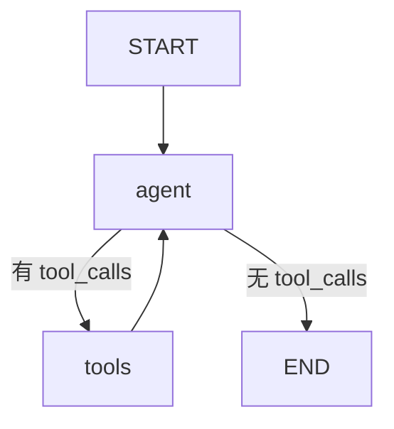

# 05 用 LangGraph 手写一个 ReAct Agent（附状态流转图）

> 对应技能：Agent 状态编排 ｜ **状态：已跑通（纯标准库手写 StateGraph，运行证据在 `multi-agent/evidence/`）**
>
> 本环境无 langgraph，用标准库实现等价的状态图（节点/条件边/路由），消息链与 Mermaid 图均为真实运行产出。装好 langgraph 后 `multi-agent/` 保留了升级入口。

## 1. 背景与目标

`create_react_agent` 是封装好的高层 API，但面试一定会问"底层怎么实现"。目标是手写一个 ReAct 循环（思考-行动-观察），理解模型节点、工具节点和条件边如何协作，并能画出状态流转图。

## 2. 环境与依赖

- Python 3.11+；本环境用标准库实现，无需外部依赖
- 复用项目一 RAG 链作为检索工具（`search_kb`）
- 有 `DEEPSEEK_API_KEY` 时自动切真实 Function Calling，无 Key 时用确定性本地决策（不编造知识）

## 3. 核心实现

Step 1 工具定义 + Schema 校验 + 有限重试（`multi-agent/tools.py`）：

```python
class SearchInput:                      # 等价 Pydantic BaseModel
    def __init__(self, query: str):
        if not isinstance(query, str): raise ValidationError("query 必须是字符串")
        if not query.strip():          raise ValidationError("query 不能为空")
        self.query = query

def invoke_tool(name, params, retries=2, delay=0.01):
    while attempts <= retries:
        try:
            schema(**params)            # 校验先行；参数错误不重试
            return fn(**params)
        except ValidationError:
            raise
        except Exception:               # 执行期异常才重试 + 指数退避
            attempts += 1
            if attempts <= retries: time.sleep(delay * (2 ** (attempts-1)))
```

Step 2/3 手写 ReAct 状态图（`multi-agent/react_agent.py`）：

```python
def call_model(state):
    last = state.messages[-1]
    if last.role == "tool":             # 观察后产出最终答案
        return {"messages": [Message("ai", f"根据检索到的证据：\n{last.content}")]}
    decision = llm.decide(last.content) # 是否调用工具
    if decision["tool"]:
        return {"messages": [Message("ai", "", tool_calls=[decision])]}
    return {"messages": [Message("ai", "无需检索知识库。")]}

def should_continue(state):             # 条件边
    return "tools" if state.messages[-1].tool_calls else "__end__"

builder = StateGraph()
builder.add_node("agent", call_model)
builder.add_node("tools", tool_node)
builder.add_edge("START", "agent")
builder.add_conditional_edges("agent", should_continue,
                              {"tools": "tools", "__end__": "__end__"})
builder.add_edge("tools", "agent")
```

状态流转图（真实运行 `state_graph_mermaid.md` 输出）：



## 4. 关键参数与踩坑

- **路由顺序**：节点执行完后要**先走条件边**判断下一步，不能只看普通边——否则 agent 节点没有普通边会直接跳到 END，ReAct 循环只跑一步就断（这是我实际踩到并修复的 bug）。
- `should_continue` 检查最后一条消息有没有 `tool_calls`：有去工具节点，没有到 END。
- 工具节点执行完把结果作为 `ToolMessage` 追加回状态，再回到模型节点——这是"观察"环节。
- 参数校验错误**不重试**（传错参数重试无意义），只对执行期异常有限重试 2 次 + 指数退避。

## 5. 结果验证（已跑通，证据在 `multi-agent/evidence/`）

`react_message_chain.json` 真实消息链（问题："混合检索为什么要用BM25"）：

```
HumanMessage  : 混合检索为什么要用BM25
AIMessage     : (tool_calls=[search_kb])
ToolMessage   : name=search_kb，内容=[
                  来源: 01_rag_concepts#000, ...]
AIMessage     : 根据检索到的证据回答：... [来源: ...]
```

`react_no_tool.json`：问"你好"时不调用工具，直接返回——证明条件边双向都生效。

`tools_check.txt`：Schema 校验（空 query 抛 ValidationError）+ 执行期异常重试 3 次日志。

`state_graph_mermaid.md`：两张 Mermaid 图（ReAct 流转 + 三类 Agent 编排）。

## 6. 面试怎么讲

"create_react_agent 是封装，我手写了一遍 StateGraph：模型节点产出可能带 tool_calls 的消息，条件边判断有没有工具调用，有就走 ToolNode 并把结果追加回状态，没有就到 END。这对应 ReAct 的思考-行动-观察。我实际踩过一个坑：节点执行后如果先取普通边，agent 没有普通边会直接结束，循环只跑一步——要优先走条件边。工具参数用 Schema 校验，失败有限重试 2 次加指数退避。证据是完整 4 条消息链，可以直接打开 `react_message_chain.json` 看。"
